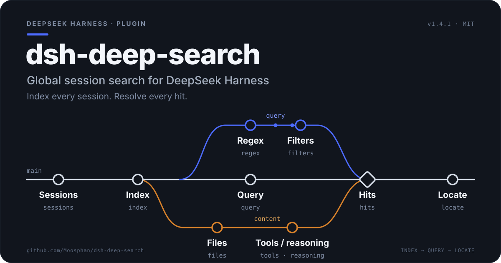
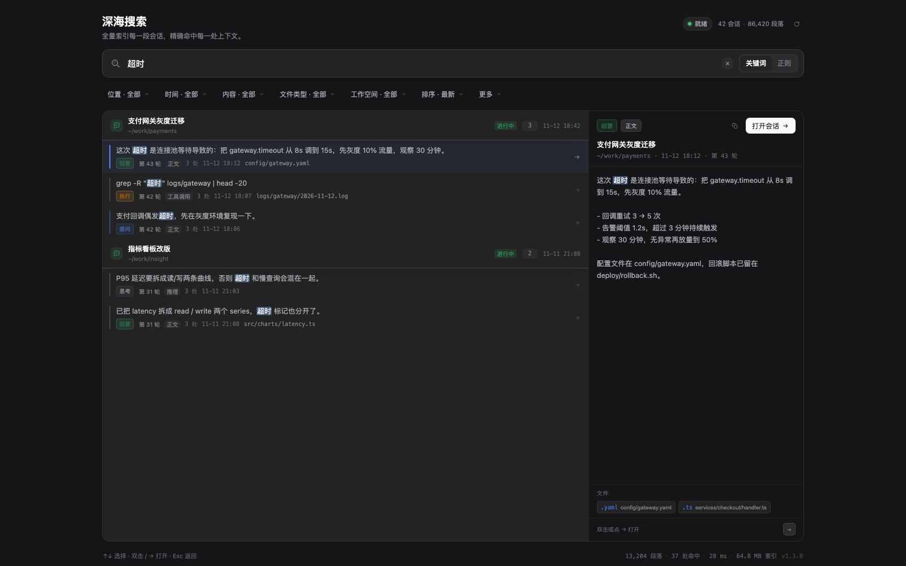
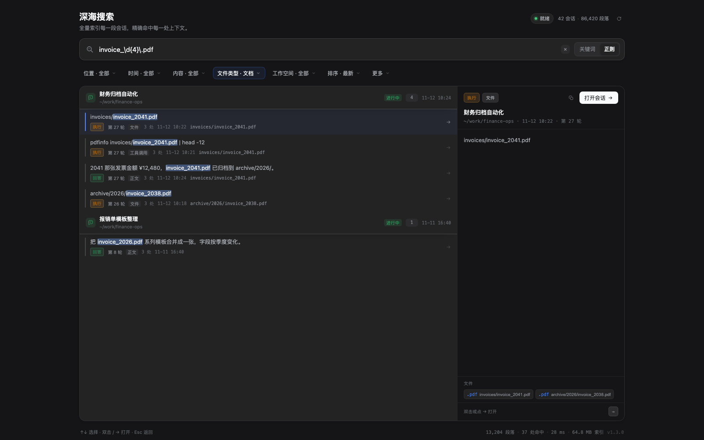
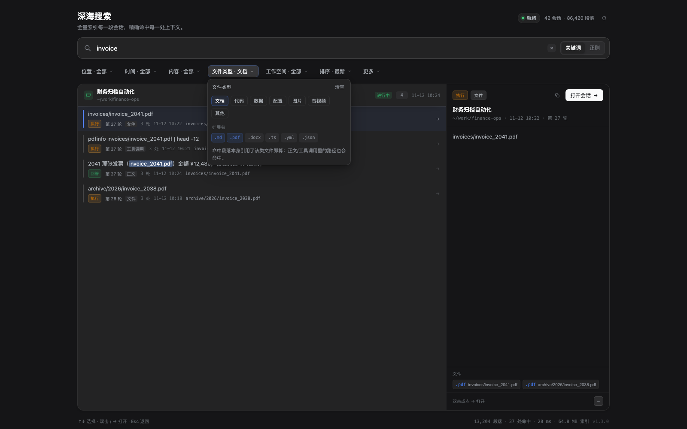
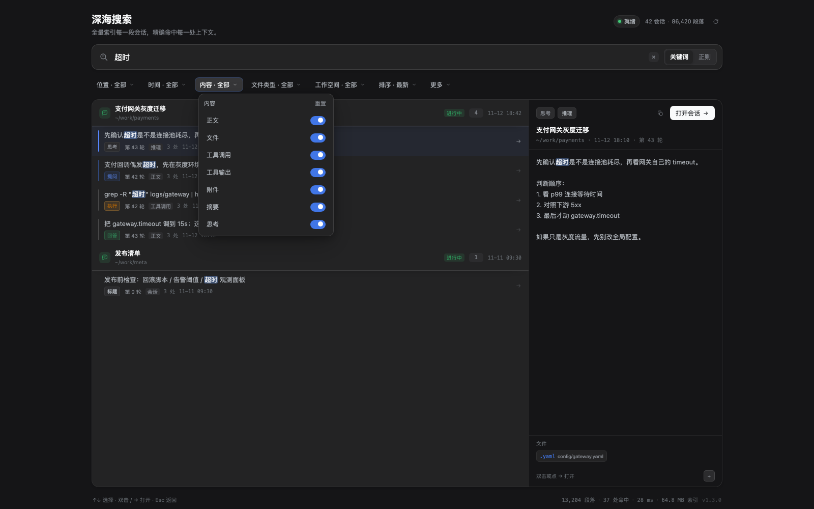
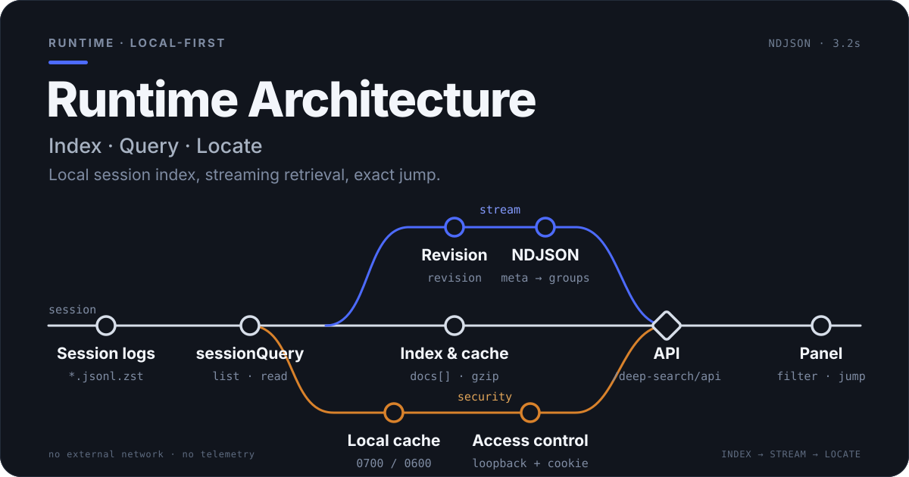

<p align="center"><a href="README.md">中文</a> · <strong>English</strong></p>

<p align="center">
  
</p>

<h1 align="center">dsh-deep-search</h1>

<p align="center">Global session search for DeepSeek Harness: a local index over every logical session, with keyword/regex search, composable filters, streaming results, and exact jumps.</p>

<p align="center">
  <a href="https://github.com/Moosphan/dsh-deep-search/releases"></a>
  <a href="LICENSE"></a>
  <a href="https://github.com/Moosphan/dsh-deep-search/actions/workflows/ci.yml"></a>
  
  
  
  <a href="https://github.com/Moosphan/dsh-deep-search/stargazers"></a>
</p>

---

## Background

DSH session history grows continuously, while native search is centered on titles and the current session. `dsh-deep-search` builds a local retrieval index over every logical session, supports composable filters and streaming results, and resolves each hit back to its original turn or tool call.

## Features

| Capability | Description |
| --- | --- |
| Full index | Reads every logical session through the Host `sessionQuery`, preferring live state and falling back to persisted logs. |
| Keyword / regex | Literal and JavaScript regex modes; unsafe backtracking patterns are rejected before matching, with a 3.2s soft deadline per search. |
| Composable filters | Time, workspace, ask/AI, body/file/tool/output/reasoning/attachment/summary, file type, extension, sort, case, whole word, and title. |
| Location labels | Each hit is labeled `Ask` / `Answer` / `Execute` / `Reasoning` / `Title`, with content type, turn, time, and path. |
| File-first search | Attachments, tool-call paths, and prose paths become first-class file documents; file-type filters also match files referenced inside body text or tool calls. |
| Newest first | Scans sessions by update time by default and orders hits within a group newest first; `Relevance` scores the full set before streaming. |
| Streaming | `/deep-search/api` streams `meta → groups → done` as NDJSON, so the first results render before the full search completes; identical queries reuse a 15s result cache. |
| Exact jump | Prefers the host turn rail (loading unseen turns through `loadThrough`), then resolves by call ID or turn; collapsed execution steps expand automatically. |
| Position memory | Selected hit, scroll position, query, and filters persist across session switches. |
| Retry | Transient `Failed to fetch` errors from Host reloads or connection churn retry three times with backoff. |

## Screenshots

<table>
  <tr>
    <td width="50%"><br/><sub>Session groups, location labels, and full-text preview.</sub></td>
    <td width="50%"><br/><sub>Regex and file-type filters combined.</sub></td>
  </tr>
  <tr>
    <td><br/><sub>File type and extension filters.</sub></td>
    <td><br/><sub>Body, file, tool, and reasoning content toggles.</sub></td>
  </tr>
</table>

<sub>UI shown in Chinese; the panel follows the DSH locale.</sub>

## Installation

**Plugin marketplace**: DSH → Plugins → Marketplace → search `dsh-deep-search` or `深海搜索` → Install → restart DSH.

**CLI**:

```bash
dsh plugin add dsh-deep-search
dsh plugin --profile desktop add dsh-deep-search
```

**From source**:

```bash
git clone https://github.com/Moosphan/dsh-deep-search.git
dsh plugin add link:"$PWD/dsh-deep-search"
dsh plugin --profile desktop add link:"$PWD/dsh-deep-search"
```

The Host half is loaded when the DSH process starts; fully quit and reopen DSH after installation.

## Usage

1. Open **dsh-deep-search** in the left sidebar, above **Plugins**.
2. Enter a keyword or switch to regex; `Enter` in the input only starts a search and never jumps.
3. Double-click a hit, click the `→` button on its row, or use **Open session** in the preview.
4. Narrow results with the filter bar: location, time, content, file type, workspace, and sort.
5. Sticky session headers are section labels only and do not respond to clicks.

Keyboard: `↑` / `↓` selects a hit, double-click or `→` opens it, `Esc` clears the selection and returns to the conversation.

### Filter semantics

| Filter | Semantics |
| --- | --- |
| Location | `Ask` = user message; `Answer` = assistant text; `Execute` = tool calls/output; `Reasoning` = reasoning; `Title` = session title. |
| File type | Matches when the hit references a file of that type; a standalone file row is not required. |
| Time | Filters by event time, not session creation time. |
| Workspace | Exact match on the session `cwd`. |
| Sort | `Newest` by default; `Relevance` combines hit count, content-type weight, and recency. |

## Performance & Architecture

<p align="center"></p>

- **Index**: one gzip + v8-serialized cache per session, with background migration of old JSON caches; live sessions are parsed incrementally from an event cursor, appending only new events. Warm cache serves results immediately while refresh runs in the background.
- **Cold start**: recent sessions are indexed first, so the panel can return partial results while older sessions fill in.
- **Build**: large sessions yield to the event loop every 2,000 events so the Host HTTP server stays responsive; first cold start reads sessions serially and reports progress.
- **Cache**: `~/.dsh/plugin-data/deep-search/index/`, directories `0700` and files `0600`; searchable text only.
- **Limits**: 8,000 characters per document, 5,000 per tool output; 30 hits per session and 48 groups globally; 3.2s soft deadline per search.
- **Typical performance**: 20–80 ms for 40–100 sessions and around 100k documents on Apple Silicon. See [performance-results](docs/performance-results.md) for the before/after benchmark.

## Security & Privacy

- The Host reads only local session logs; no external requests, telemetry, or cloud index.
- `/deep-search/api` accepts loopback requests only and reuses the host `connection.requestRejection` cookie check.
- The cache contains searchable text only, never attachment binaries; delete `~/.dsh/plugin-data/deep-search` to remove it.
- The index contains session bodies and tool output; treat the DSH home directory as sensitive local data.

## Compatibility

- DeepSeek Harness Desktop / Web, Node.js >= 20.
- Subagent logs that are not visible through `sessionQuery.listSessions()` are not indexed.
- Jumping requires the session window to load the relevant history; extreme virtualization can fall back to turn-level positioning.
- Regex uses JavaScript `RegExp`; `(?<name>)` works, unsafe backtracking patterns are rejected.

## Development

```bash
npm test
npm run check
```

```text
index.js            Host: index, parsing, filters, /deep-search/api, NDJSON streaming
client.js           Client: sidebar entry, panel, filters, preview, jump
locale/*.json       Marketplace metadata
cordis.patch.yml    Bundle insert row
docs/               Hero, architecture, panel screenshots, and mock sources
test/               Headless Host and Client tests
```

No build step. Plain ESM JavaScript with no runtime dependencies.

## License

[MIT](LICENSE) © 2026 Moosphan
