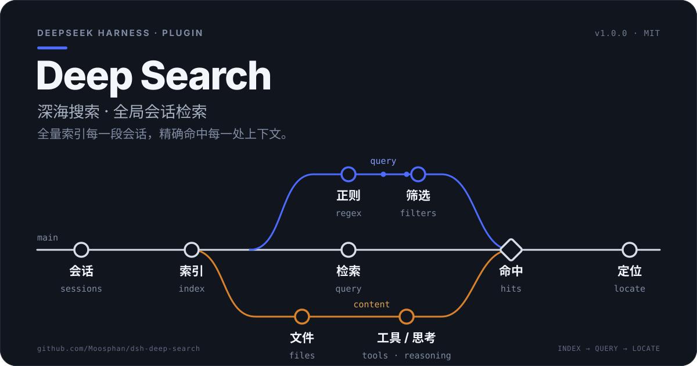
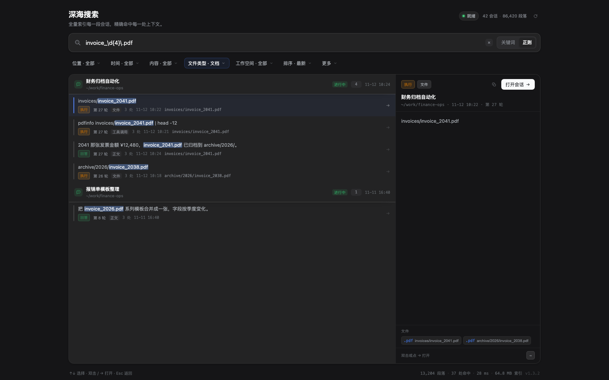
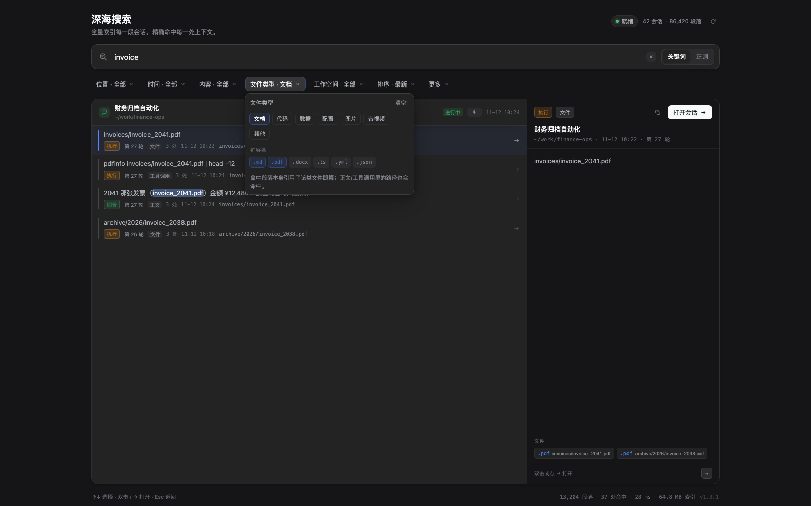
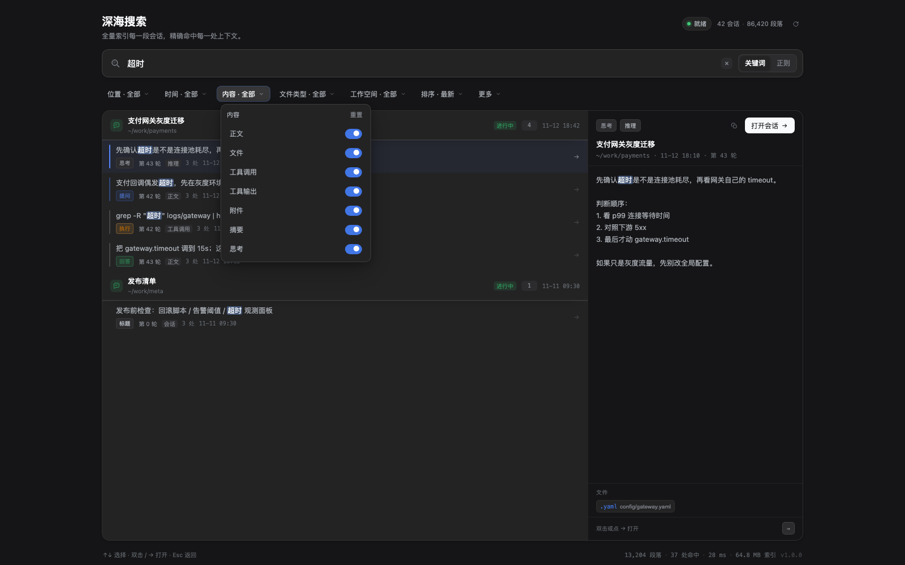
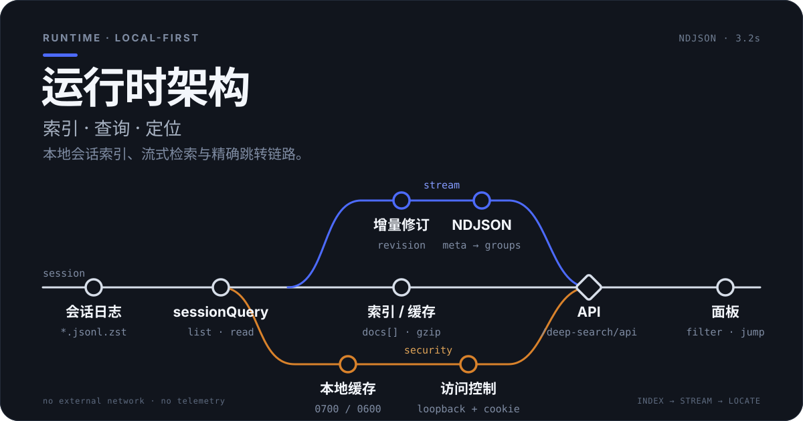

<p align="center"><a href="README.en.md">English</a> · <strong>中文</strong></p>

<p align="center">
  
</p>

<h1 align="center">dsh-deep-search · 深海搜索</h1>

<p align="center">DeepSeek Harness 的全局会话检索插件：本地索引全部逻辑会话，支持关键词/正则、组合筛选、流式结果与精确跳转。</p>

<p align="center">
  <a href="https://github.com/Moosphan/dsh-deep-search/releases"></a>
  <a href="LICENSE"></a>
  <a href="https://github.com/Moosphan/dsh-deep-search/actions/workflows/ci.yml"></a>
  
  
  
  <a href="https://github.com/Moosphan/dsh-deep-search/stargazers"></a>
</p>

---

## 背景

DSH 的会话历史持续增长，原生搜索主要覆盖标题与当前会话。<code>dsh-deep-search</code> 为全部逻辑会话建立本地检索索引，支持多条件筛选、流式返回，并将命中定位回原始轮次或工具调用。

## 功能

| 能力 | 说明 |
| --- | --- |
| 全量索引 | 通过 Host `sessionQuery` 读取每个逻辑会话的完整日志，live 优先、持久化兜底。 |
| 关键词 / 正则 | 字面量与 JavaScript 正则双模式；危险回溯写法在匹配前拦截，单次检索 3.2s 软截止。 |
| 组合筛选 | 时间、工作空间、提问/AI、正文/文件/工具/输出/思考/附件/摘要、文件类型、扩展名、排序、大小写、全词、标题。 |
| 位置标签 | 每条命中标注 `提问` / `回答` / `执行` / `思考` / `标题`，并显示内容类型、轮次、时间与路径。 |
| 文件检索 | 附件、工具调用路径、正文路径均建立独立文件段落；文件类型筛选同时覆盖正文/工具中对文件的引用。 |
| 最近优先 | 默认按会话更新时间从近到远扫描，命中组内按时间倒序；`相关` 模式全量打分后下发。 |
| 流式返回 | `/deep-search/api` 以 NDJSON 分批返回 `meta → groups → done`，首屏无需等待完整结果。 |
| 精确跳转 | 优先调用宿主轮次导航（未加载轮次自动 `loadThrough`），再按调用 ID / 轮次定位；折叠步骤自动展开。 |
| 位置记忆 | 选中命中、滚动位置、查询与筛选均持久化，切换会话后返回仍恢复原视图。 |
| 失败重试 | Host 重载或连接抖动导致的 `Failed to fetch` 自动退避重试 3 次。 |

## 界面

<table>
  <tr>
    <td width="50%"><br/><sub>主检索：会话分组、位置标签、全文预览。</sub></td>
    <td width="50%"><br/><sub>正则与文件类型组合检索。</sub></td>
  </tr>
  <tr>
    <td><br/><sub>文件类型与扩展名筛选。</sub></td>
    <td><br/><sub>正文、文件、工具、思考等内容开关。</sub></td>
  </tr>
</table>

## 安装

**插件市场**：DSH → 插件 → 市场 → 搜索 `dsh-deep-search` / `深海搜索` → 安装 → 重启 DSH。

**CLI**：

```bash
dsh plugin add dsh-deep-search
dsh plugin --profile desktop add dsh-deep-search
```

**源码安装**：

```bash
git clone https://github.com/Moosphan/dsh-deep-search.git
dsh plugin add link:"$PWD/dsh-deep-search"
dsh plugin --profile desktop add link:"$PWD/dsh-deep-search"
```

Host 半边仅在 DSH 进程启动时加载；安装后需完全退出并重新打开 DSH。

## 使用

1. 打开左栏「深海搜索」（位于「插件」上方）。
2. 输入关键词或切换正则模式；输入框内 `Enter` 仅触发检索，不执行跳转。
3. 双击命中、点击行右侧 `→`，或使用预览区的「打开会话」完成跳转。
4. 通过筛选条按位置、时间、内容、文件类型、工作空间与排序收窄结果。
5. 会话标题吸顶仅作分区提示，不响应点击。

快捷键：`↑` / `↓` 选择命中，双击或 `→` 打开，`Esc` 清空选择/返回对话。

### 筛选语义

| 条件 | 语义 |
| --- | --- |
| 位置 | `提问` 用户消息；`回答` assistant 文本；`执行` 工具调用/输出；`思考` reasoning；`标题` 会话标题。 |
| 文件类型 | 命中段落引用了该类文件即匹配，不要求是独立文件行。 |
| 时间 | 按事件时间过滤，不以会话创建时间代替。 |
| 工作空间 | 按会话 `cwd` 精确匹配。 |
| 排序 | 默认「最新」；「相关」按命中数、内容类型权重与新鲜度综合排序。 |

## 性能与架构

<p align="center"></p>

- **索引**：每会话一份 zstd 缓存；修订号未变化时直接复用，live 会话按事件数增量重读。
- **构建**：单个大会话每 2000 个事件让出事件循环，Host HTTP 服务保持可响应；首次冷启动按会话串行读取并展示进度。
- **缓存**：`~/.dsh/plugin-data/deep-search/index/`，目录 `0700`、文件 `0600`；仅保存可搜索文本。
- **上限**：单段文本 8 000 字符、工具输出 5 000 字符；单会话 30 条命中、全局 48 组；单次检索 3.2s 软截止。
- **典型性能**：40–100 个会话、10 万段落量级，全量检索约 20–80 ms（Apple Silicon）。

## 安全与隐私

- Host 仅读取本地会话日志，不发起外网请求，无遥测与云索引。
- `/deep-search/api` 仅接受 loopback 请求，并复用宿主 `connection.requestRejection` 的 Cookie 校验。
- 缓存只包含可搜索文本，不复制附件二进制；删除 `~/.dsh/plugin-data/deep-search` 即可清除索引。
- 索引包含会话正文与工具输出，应按敏感本地数据管理 DSH home 权限。

## 兼容性

- DeepSeek Harness Desktop / Web，Node.js >= 20。
- 子代理日志若不在 `sessionQuery.listSessions()` 中可见，则不会被索引。
- 跳转依赖会话窗口可加载对应历史；极端虚拟化场景下可能定位到轮次而非具体调用。
- 正则使用 JavaScript `RegExp`；`(?<name>)` 可用，危险回溯写法会被拒绝。

## 开发

```bash
npm test
npm run check
```

```text
index.js            Host：索引、解析、筛选、/deep-search/api、NDJSON 流
client.js           Client：侧栏入口、面板、筛选、预览、跳转
locale/*.json       插件市场元数据
cordis.patch.yml    bundle 插入行
docs/               hero、架构图、面板图与 mock 源文件
test/               Host 与 Client 无头测试
```

无构建步骤，纯 ESM JavaScript，无运行时依赖。

## License

[MIT](LICENSE) © 2026 Moosphan
