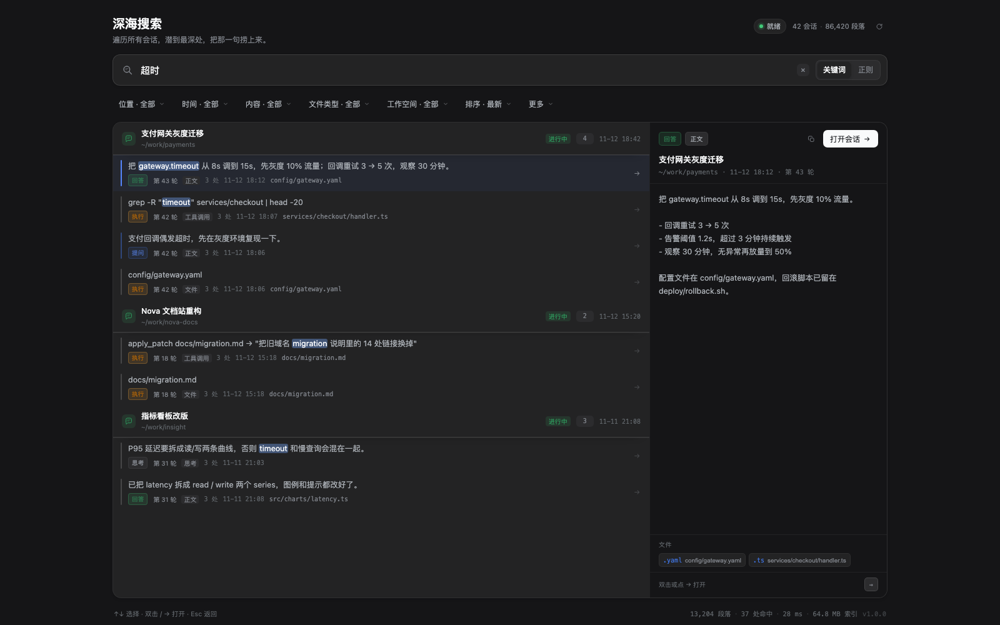
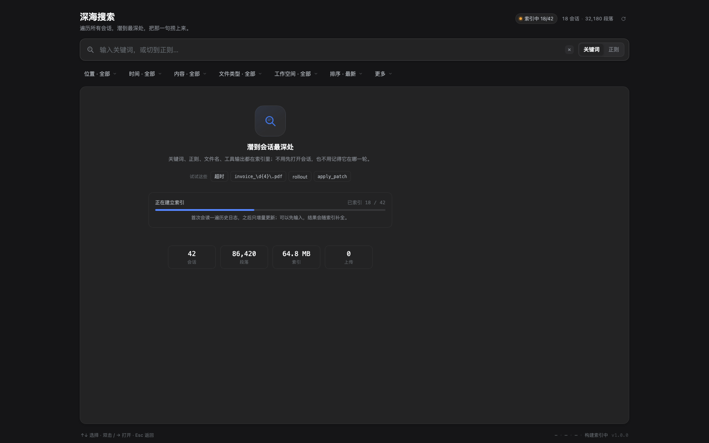

<p align="center">
  
</p>

<h1 align="center">Deep Search · 深海搜索</h1>

<p align="center"><strong>潜到会话最深处，把那一句捞上来。</strong><br/>
DeepSeek Harness 的本地优先全局会话检索插件。</p>

<p align="center">
  <a href="https://github.com/Moosphan/dsh-deep-search/releases"></a>
  <a href="LICENSE"></a>
  <a href="https://github.com/Moosphan/dsh-deep-search/actions/workflows/ci.yml"></a>
  
  
  
  <a href="https://github.com/Moosphan/dsh-deep-search/stargazers"></a>
</p>

---

## 名字

**Deep Search / 深海搜索**。

- **Deep**：DeepSeek，也指「深」——历史越久、会话越多，越值得往下潜。
- **Search**：包名和产品名都直接包含 `search` / `搜索`，在插件市场、GitHub 和搜索引擎里都能被准确找到。
- **深海**：每个会话是一片海，每句话是一颗气泡；Deep Search 做的不是「翻聊天记录」，而是带着探照灯潜下去，把那一句捞上来。

> 这不是又一个「会话列表筛选器」。它是一层覆盖所有会话的检索索引：关键词、正则、时间、工作空间、提问/回答/执行、文件类型，最后精确跳回原轮次或那次工具调用。

---

## 为什么诞生

DeepSeek Harness 的会话越用越多。几周之后，你记得「当时讨论过一个方案」「那条命令的输出里有答案」「那个 `.md` 文件是在某次对话里写的」，但：

- 原生搜索擅长标题和当前会话，跨会话翻旧账很费劲；
- 会话一一切换去找，翻到一半就忘了要找什么；
- 已有的检索插件往往只覆盖标题/最近轮次，没有正则、没有「提问/回答/执行」区分、没有工作空间和文件类型组合筛选；
- 找到了还不一定跳得准：大型会话是分页加载的，命中点在历史深处。

Deep Search 因此而生：**把所有逻辑会话折叠成可检索的语义索引，在一页里搜索、组合筛选、流式返回，并精确跳回原来的轮次或工具调用。** 全部在本地完成。

---

## 功能

| | |
|---|---|
| **全量索引** | 通过 Host 的 `sessionQuery` 读取每个逻辑会话的完整日志，live 优先、持久化兜底；不是只搜当前窗口。 |
| **关键词 / 正则** | 字面量与 JavaScript 正则双模式；危险回溯写法在匹配前拦截，单次检索有 3.2s 软截止。 |
| **组合筛选** | 时间、工作空间、提问/AI、正文/文件/工具/输出/思考/附件/摘要、文件类型、扩展名、排序、大小写、全词、标题。 |
| **一眼分清在哪** | 每条命中带 `提问` / `回答` / `执行` / `思考` / `标题` 位置标签，加上内容类型、轮次、时间和路径。 |
| **文件名是一等公民** | 用户附件、工具调用路径参数、正文里的路径都会单独建立 `file` 段落；选文件类型时，正文/工具调用里提到该类文件的命中也会保留。 |
| **最近优先 + 流式** | 默认「最新」：会话按更新时间从近到远扫描，发现一个会话就推一组 NDJSON；组内最新命中在前。 |
| **精确跳转** | 优先点击宿主自己的轮次导航（未加载轮次自动 `loadThrough`），再按 `data-chat-call-id` / `data-chat-turn` 细化到工具调用；折叠的执行步骤自动展开。 |
| **点箭头也能跳** | 命中行右侧的打开按钮可单独点击，悬停有描边；双击命中也打开。 |
| **位置会记住** | 选中的命中、列表滚动位置、查询与筛选都会写入 `localStorage`；跳到别的会话再回来，仍停在原来的高亮处。 |
| **失败自动重试** | Host 重载、索引构建或连接抖动导致的 `Failed to fetch` 会自动退避重试 3 次。 |
| **像 DSH 自己的页面** | 全部使用 `--dsw-*` 主题 token；明暗主题自动跟随，吸顶会话标题只作分区提示、不响应点击。 |

---

## 界面

> 以下截图为**虚拟示例数据**（Nova、payments、finance-ops 等均为虚构项目），用于展示功能，不包含任何真实用户会话。

<table>
  <tr>
    <td width="50%"><br/><sub>主检索：会话 → 命中，位置标签与右侧全文预览。</sub></td>
    <td width="50%"><br/><sub>正则 + 文件类型：`invoice_\d{4}\.pdf` 直接落到 PDF 路径。</sub></td>
  </tr>
  <tr>
    <td><br/><sub>文件类型 / 扩展名组合筛选。</sub></td>
    <td><br/><sub>正文 / 文件 / 工具 / 思考等内容开关。</sub></td>
  </tr>
  <tr>
    <td colspan="2"><br/><sub>首次建立索引：进度、语料统计与示例检索。</sub></td>
  </tr>
</table>

---

## 安装

### 插件市场（推荐）

DSH → **插件** → **市场** → 搜索 **Deep Search**、**深海搜索** 或 **dsh-deep-search** → 安装 → 按提示重启 DSH。

### CLI

```bash
# 普通 web / headless profile
dsh plugin add dsh-deep-search

# 桌面端 profile
dsh plugin --profile desktop add dsh-deep-search
```

Host 半边只在 DSH 进程启动时加载；安装后请**完全退出并重新打开 DSH**，仅刷新页面不够。

### 从源码

```bash
git clone https://github.com/Moosphan/dsh-deep-search.git
cd dsh-deep-search
dsh plugin add link:"$PWD"

# 桌面端
dsh plugin --profile desktop add link:"$PWD"
```

开发时也可以用 profile 的 `cordis.patch.yml` 手动挂载：

```yaml
- insert:
    - id: deep-search
      name: dsh-deep-search
```

---

## 使用

1. 打开左栏 **深海搜索**（在「插件」上方）。
2. 输入关键词或切到 **正则**。输入框里的 `Enter` 只立即检索，不会跳走。
3. 双击命中、点右侧 `→`，或点预览里的「打开会话」跳转；会话标题吸顶只作分区提示，不响应点击。
4. 用筛选条收窄：位置、时间、内容、文件类型、工作空间、排序、更多。
5. 跳到别的会话后回来，面板会恢复上次的查询、筛选、选中命中与滚动位置。

快捷键：`↑` / `↓` 选择命中，双击或 `→` 打开，`Esc` 先清选择、再返回对话。

常用检索：

```text
超时                        # 关键词
invoice_\d{4}\.pdf          # 正则：所有归档发票
"apply_patch"               # 精确短语
第\s*269\s*轮               # 正则：轮次
```

### 筛选语义

- **位置**：`提问` = 用户；`回答` = assistant 文本；`执行` = 工具调用/输出；`思考` = reasoning；`标题` = 会话标题。
- **文件类型**：命中段落本身引用了该类文件即算；不要求是独立的文件行。
- **时间**：按事件时间，不是会话创建时间。
- **工作空间**：按会话 `cwd` 精确匹配。
- **排序**：默认「最新」；「相关」= 命中数（封顶 6）+ 内容类型权重 + 新鲜度。

---

## 性能与架构

```
~/.dsh/sessions/**/*.jsonl.zst
        │  ctx.sessionQuery.listSessions() + readSession()
        ▼
Host: parseSession() → docs[]（message / file / tool / output / reasoning / attachment / summary）
        │  修订号 = live 事件数，或 persistence revision + sizeBytes
        ▼
内存索引 entries: Map<sessionId, {cwd,title,updatedAt,docs,chars}>
        │  仅变更会话重读；每会话一份 zstd 缓存
        ▼
POST /deep-search/api  →  NDJSON（meta → groups → done）
        │  loopback + 宿主 Cookie 校验
        ▼
Client: sidebar.panellist(order=-1) + main(key=deep-search)
```

- **缓存**：`~/.dsh/plugin-data/deep-search/index/`（桌面端未注入 profile 时）。目录 `0700`、文件 `0600`。
- **增量**：会话日志修订没变就复用；live 会话按事件数变化重读；索引过期 20s 后后台刷新。
- **解析让出**：单个大会话每 2000 个事件 `setImmediate` 一次，Host 的 HTTP 循环不会被长时间独占。
- **冷启动**：首次构建按会话串行读取并显示进度；之后从缓存加载，约 1–2s。
- **上限**：单段文本 8 000 字符、工具输出 5 000 字符；单会话最多 30 条命中、全局 48 组；单次检索 3.2s 软截止并标记「结果已截断」。
- **典型性能**：40–100 个会话、10 万段落量级，全量检索约 20–80 ms（M 系列 Mac）。

---

## 安全与隐私

- **不联网**：Host 只读本地会话日志，不发起任何外网请求；没有遥测、没有账号、没有云索引。
- **只接受本机**：`/deep-search/api` 只接受 loopback 请求，并复用宿主 `connection.requestRejection` 的 Cookie 校验；无凭据返回 403。
- **最小缓存**：只缓存可搜索文本，不复制附件二进制；目录 `0700`、文件 `0600`。
- **可清除**：删除 `~/.dsh/plugin-data/deep-search` 即可清空索引；下次会自动重建。
- **注意**：索引包含会话正文与工具输出，按敏感本地数据对待；共享机器上请自行管理 DSH home 权限。

---

## 兼容性与边界

- 目标：DeepSeek Harness Desktop / Web，Node.js >= 20。
- 子代理日志如果在 `sessionQuery.listSessions()` 里不可见，就不会被索引。
- 跳转依赖会话窗口已加载/可加载到对应历史；极端虚拟化边界下会退化为「定位到轮次」。
- 正则使用 JS `RegExp`；`(?<name>)` 可用，危险回溯写法会被拒绝。
- 极长的单条工具输出只索引前 5 000 字符。
- 首次冷启动需要读一遍历史日志，时间取决于会话数量和体积。

---

## Roadmap

- 将索引构建移入 worker thread，进一步降低主线程占用；
- 保存检索视图 / 多组固定筛选；
- 结果导出（JSON / Markdown）；
- 会话内快速唤起面板；
- 更细的文件类型与语言识别。

欢迎 issue / PR，尤其是大型语料下的性能样本。

---

## 开发

```bash
npm test     # node --test：Host 路由、解析、筛选、流式输出 + Client 冒烟
npm run check
```

结构：

```text
index.js            Host：索引、解析、筛选、/deep-search/api、NDJSON 流
client.js           Client：侧栏入口、整页面板、筛选、预览、跳转
locale/*.json       插件市场标题/描述
cordis.patch.yml    bundle 插入行
docs/               宣传原画、模拟面板图、mock 源文件
test/               Host + Client 无头测试
```

无需构建步骤；纯 ESM JavaScript，无运行时依赖。

---

## License

[MIT](LICENSE) © 2026 Moosphan

<p align="center"><sub>Dive deep. Bring that line back.</sub></p>
